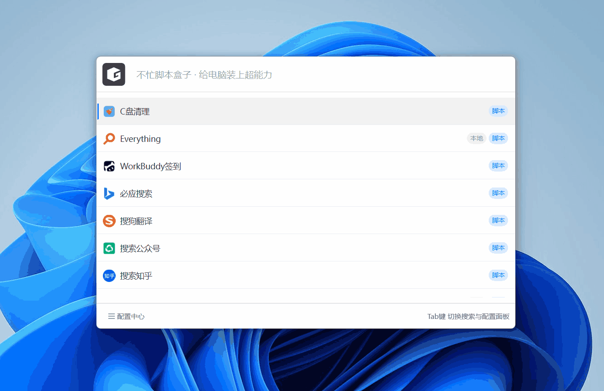

# Everything 搜索

> 在盒子搜索框敲下关键词，Everything 立刻带着这个词打开，搜索本地文件一步到位。

## 核心特性

- **搜索框直达**：盒子里输入关键词，点一下推荐项，Everything 弹出窗口并自动完成搜索。
- **自带便携版**：安装脚本时自动准备好 Everything 便携版，电脑上原本没装也能用；不写注册表、不改系统环境变量。
- **优先用你现有的**：本机已装 Everything 就先调用它，索引现成，不必等重新建库。
- **语法全保留**：`ext:pdf`、`path:`、`regex:`、`|` 等 Everything 搜索语法原样生效。
- **不占终端**：窗口交给 Everything，脚本启动完就退出，不留黑框。

## 脚本演示

## 安装方法

盒子 → 脚本市场 → 搜索「Everything」→ 安装。

安装时盒子会自动下载 Everything 便携版（约 2 MB），不需要手动安装任何东西。

## 使用方式

### 搜索框触发

1. 在盒子主界面的搜索框输入要找的内容，例如 `年度总结`、`ext:pdf 合同`。
2. 在搜索结果里点「Everything 搜索」。
3. Everything 窗口弹出，结果已按关键词筛选好。

> 便携版 Everything 第一次运行会先建立本地索引，这段时间结果可能不全，索引跑完即恢复正常。

### 直接启动

在盒子里点脚本卡片，直接打开 Everything 主窗口，不带搜索词。

### 关于管理员权限

- 电脑上**已经装过** Everything：脚本直接用它的系统服务跑，全程不会请求管理员权限。
- 电脑上**没装**、使用盒子自带的便携版：便携版没有常驻服务，读 NTFS 索引必须提权，所以启动时可能弹出管理员授权窗口，点「是」即可。

想彻底告别这个弹窗，装一次 Everything 正式版就行——安装程序会顺带装好系统服务，脚本检测到它会自动优先使用。
